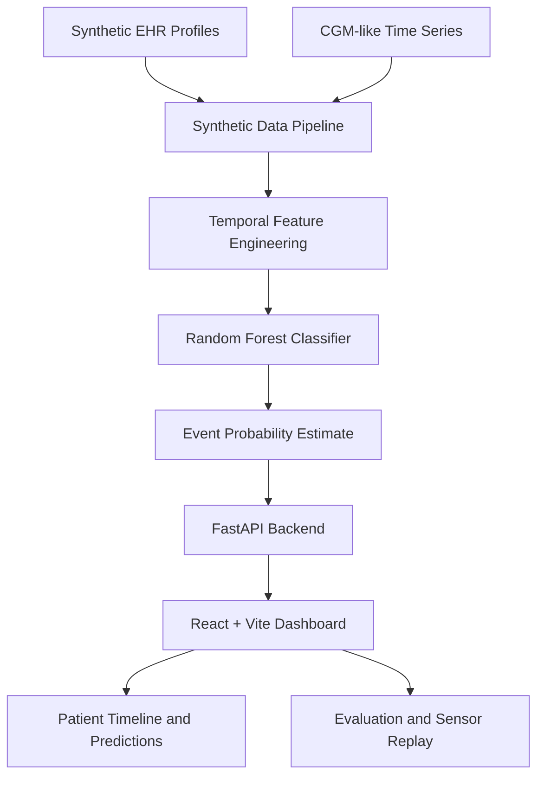

# GlycoTwin AI
### A Personalized Digital Twin for Predicting Glucose Excursions

**Happiest Health — Reimagining and Reforming Healthcare in India Summit 2026**

GlycoTwin AI is a healthcare AI proof of concept that explores how a personalized digital twin could help anticipate potential glucose excursions using synthetic electronic health record (EHR) profiles and continuous glucose monitoring (CGM)-like time-series data.

The prototype generates synthetic patient profiles and glucose readings, extracts historical time-series features, and uses a Random Forest classifier to estimate whether glucose will cross an illustrative **180 mg/dL threshold within the next 120 minutes**. Results are presented through an interactive dashboard designed to make patient timelines, predictions, and model limitations easier to explore.

> **Research prototype only.** GlycoTwin AI uses synthetic data and has not been clinically validated. Its predictions must not be used to make medical decisions.

## 1. The Problem

Glucose levels change over time in response to a range of physiological and lifestyle factors. Understanding potential future excursions is an important research direction for personalized diabetes care.

However, a predictive system must do more than display a glucose value or report overall accuracy. It should consider the patient's history, evaluate its predictions appropriately, and communicate uncertainty and limitations.

GlycoTwin AI explores this direction through a reproducible, synthetic-data-based pipeline that combines patient profiles, historical glucose patterns, machine learning, and an interactive digital-twin-style dashboard.

## 2. Our Approach

The prototype demonstrates five connected stages:

1. **Synthetic patient generation:** Create fictional EHR-style profiles and CGM-like glucose readings.
2. **Temporal feature engineering:** Derive features from historical readings while avoiding the use of future observations as model inputs.
3. **Model training:** Train a Random Forest classifier to estimate the occurrence of a glucose-threshold crossing within the next two hours.
4. **Evaluation:** Assess performance using patient-level train/test separation, an all-negative baseline, and multiple classification metrics.
5. **Interactive exploration:** Use the React dashboard to inspect patient timelines, predictions, evaluation results, and sequential synthetic sensor replay.

## 3. Key Features

- **Synthetic data pipeline:** Reproducible generation of fictional patient profiles and timestamped glucose-like readings.
- **Personalized patient views:** Select and explore individual synthetic patient profiles.
- **Glucose timeline:** Visualize recent glucose readings and their temporal patterns.
- **Two-hour event prediction:** Display the model's estimated probability of a future threshold-crossing event.
- **Model evaluation lab:** Explore evaluation metrics and understand the effect of rare positive events.
- **Sequential replay:** Simulate incoming synthetic glucose readings through the dashboard.
- **FastAPI backend:** Provide API endpoints for patient data, timelines, predictions, replay, and model metrics.
- **React + Vite frontend:** Deliver a responsive, interactive interface.
- **Legacy Streamlit dashboard:** Retain an alternative interface for exploration.

## 4. System Architecture



The pipeline separates data generation, feature engineering, model training, API serving, and visualization. This structure makes the prototype easier to inspect, test, and extend.

## 5. Prediction Task

| Component | Description |
|---|---|
| Input data | Synthetic patient profiles and historical CGM-like readings |
| Model | Random Forest classifier |
| Prediction horizon | Next 120 minutes |
| Illustrative threshold | 180 mg/dL |
| Prediction target | Whether any of the next eight 15-minute readings crosses the threshold |
| Evaluation split | Patient-level train/test separation |
| Intended use | Research and demonstration only |

The model estimates the probability of the defined threshold-crossing event. This is **not** a diagnosis, a measure of clinical risk, or a validated forecast for an actual patient.

## 6. Technology Stack

| Layer | Technologies |
|---|---|
| Programming language | Python |
| Machine learning | scikit-learn, Random Forest |
| API | FastAPI, Uvicorn |
| Data processing | Pandas, NumPy |
| Frontend | React, TypeScript, Vite |
| Visualization | Interactive glucose timeline and dashboard charts |
| Model persistence | Joblib |
| Alternative dashboard | Streamlit |

## 7. Model Evaluation

The recorded evaluation on the synthetic test set produced the following results:

| Metric | Recorded result |
|---|---:|
| Test rows | 6,804 |
| Test patients | 9 |
| Positive-event rate | 0.76% |
| Accuracy | 99.22% |
| All-negative baseline accuracy | 99.24% |
| Balanced accuracy | 59.53% |
| Precision | 47.62% |
| Recall | 19.23% |
| ROC-AUC | 0.9608 |
| Average precision | 0.2258 |

### How to interpret these results

The positive event is rare in this synthetic test set. Consequently, accuracy alone is misleading: an all-negative classifier achieves 99.24% accuracy, slightly higher than the recorded model accuracy of 99.22%.

The recorded recall of 19.23% also shows that the model misses many positive events in this evaluation. ROC-AUC and average precision provide additional perspectives, but they do not establish clinical usefulness.

These numbers describe **one evaluation on synthetic data only**. They do not demonstrate generalization to real patients, reliable early warning, or improved health outcomes.

## 8. Getting Started on Windows

### Prerequisites

- Python 3.10
- Node.js 20 or later; Node.js 22 LTS is recommended
- npm, installed with Node.js
- Git, if cloning the repository

### Step 1: Clone the repository

```powershell
git clone https://github.com/PavithraNagarajan07/GlycoTwin-AI.git
cd GlycoTwin-AI
```

### Step 2: Set up the Python environment

Run these commands from the project root:

```powershell
py -3.10 -m venv .venv
.\.venv\Scripts\Activate.ps1
python -m pip install --upgrade pip
pip install -r requirements.txt
```

If PowerShell blocks virtual-environment activation, you can run the environment's Python directly using `.\.venv\Scripts\python.exe`.

### Step 3: Generate data and train the model

```powershell
python -m backend.train
```

Run the training step before starting the API. It generates the synthetic training data and model artifacts required by the prototype.

### Step 4: Start the FastAPI backend

Open a second terminal at the project root. Activate the same virtual environment, then run:

```powershell
.\.venv\Scripts\Activate.ps1
uvicorn backend.main:app --reload --port 8000
```

Useful local endpoints:

- API health: `http://127.0.0.1:8000/health`
- Interactive API documentation: `http://127.0.0.1:8000/docs`
- OpenAPI schema: `http://127.0.0.1:8000/openapi.json`

### Step 5: Start the React dashboard

Open a third terminal:

```powershell
cd frontend
npm install
npm run dev
```

Open the local URL printed by Vite, usually `http://127.0.0.1:5173/`.

The frontend defaults to the API at `http://127.0.0.1:8000`. If needed, copy `frontend/.env.example` to `frontend/.env` and configure `VITE_API_BASE_URL` before starting the frontend.

### Optional: Launch the legacy Streamlit dashboard

From the project root, with the Python environment active:

```powershell
streamlit run dashboard/app.py
```

The dashboard is typically available at `http://localhost:8501`.

## 9. Project Structure

```text
GlycoTwin-AI/
├── backend/       # API, training and prediction logic
├── frontend/      # React + Vite dashboard
├── dashboard/     # Legacy Streamlit interface
├── docs/          # Project documentation
├── submission/    # Presentation, architecture and demo materials
├── tests/         # Automated tests
├── artifacts/     # Generated model artifacts
├── requirements.txt
├── README.md
└── LICENSE
```

Generated datasets and model artifacts may be created locally during training rather than stored in Git. Follow the setup steps above to generate them before launching the API.

## 10. Responsible AI and Limitations

GlycoTwin AI is an exploratory engineering prototype with important limitations:

- **Synthetic data:** Patient profiles and glucose readings are fictional and do not represent a clinically validated population.
- **Limited evaluation population:** The recorded test set contains nine synthetic patients, which is insufficient to establish real-world generalization.
- **Rare positive events:** The low event prevalence makes accuracy an unreliable standalone metric.
- **Missed events:** The recorded recall indicates that many positive events were not detected.
- **No clinical validation:** No evidence establishes safety, effectiveness, or clinical utility.
- **Illustrative threshold:** The 180 mg/dL threshold is used to define a demonstration task, not to provide personalized medical advice.
- **No treatment recommendations:** The prototype does not support medication dosing, diagnosis, treatment selection, or emergency monitoring.

Before any real-world healthcare use, the approach would require appropriately governed clinical data, clinical and ethical review, external validation, calibration analysis, subgroup evaluation, privacy safeguards, and prospective assessment.

## 11. Future Directions

Potential research extensions include:

- Evaluating on appropriately licensed and governed real-world datasets.
- Improving detection of rare positive events and assessing precision–recall trade-offs.
- Measuring probability calibration and uncertainty.
- Studying patient-level generalization on larger, independent cohorts.
- Exploring additional contextual features when reliable data and appropriate permissions are available.
- Conducting clinician-led validation before considering any clinical application.

## 12. License and Intended Use

This project is provided under the license included in the repository. See [`LICENSE`](LICENSE) for the applicable terms.

GlycoTwin AI is intended for educational, research, and demonstration purposes only. It is not a medical device and must not be used for diagnosis, treatment, medication dosing, or emergency monitoring.

## Acknowledgement

Developed as a proof of concept for the **Happiest Health Digital Twin Challenge 2026**, exploring the potential of personalized digital-twin approaches in healthcare.

