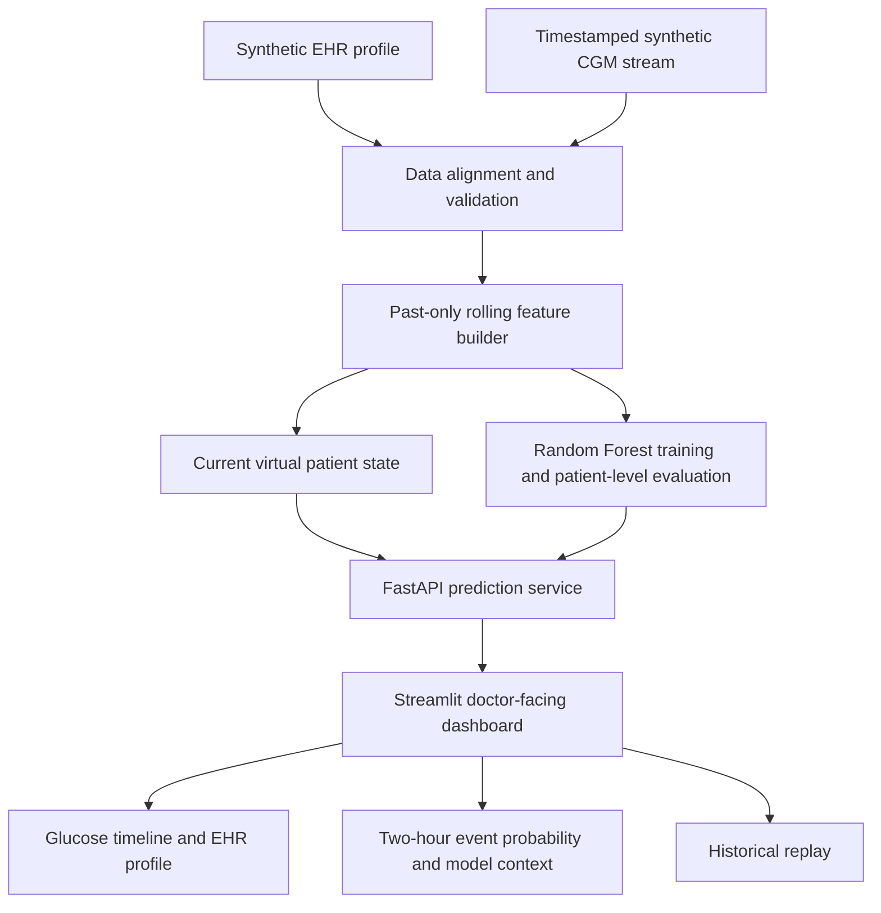

# GlycoTwin AI architecture

The training pipeline builds labels from the following eight 15-minute readings. Incomplete future windows are excluded from training. Evaluation is performed on held-out patients. All data are synthetic and model metrics are not clinical performance claims.
